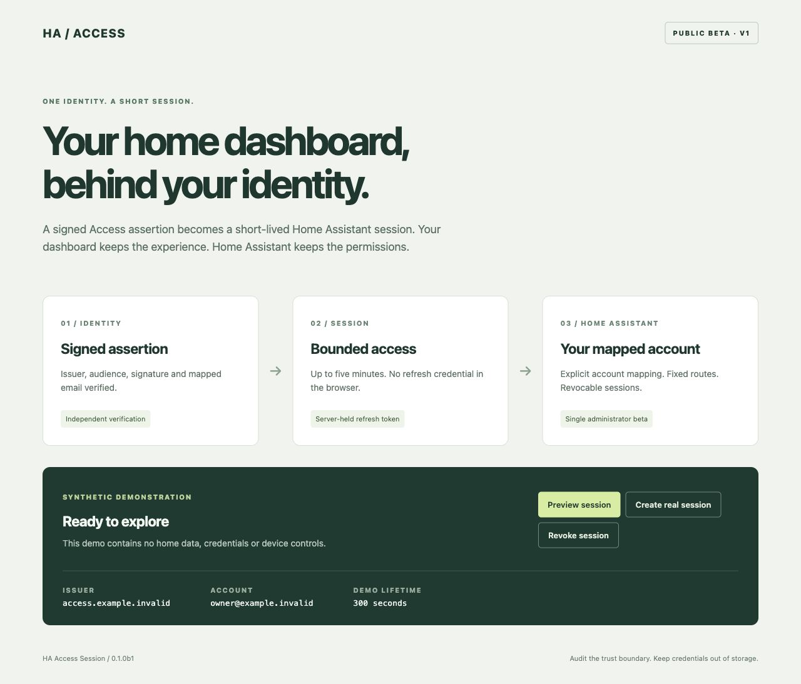

# HA Access Session

**Public beta · contract v1 · one explicitly mapped Home Assistant administrator.**

Exchange a verified Cloudflare Access application JWT for a short-lived Home Assistant access token. A small Go gateway protects your static dashboard, independently verifies the same identity, and exposes only the session exchange and HA WebSocket routes. No long-lived HA token belongs in your frontend, container environment, or gateway configuration.

This is the extracted authentication boundary, with a generic synthetic demo. It contains no floorplan UI, home model, private deployment configuration, or real identities. MIT licensed.



Source version: `0.1.0`. Download a versioned beta from [Releases](https://github.com/ha-homelab/ha-access-session/releases); its Python version uses PEP 440 (`0.1.0bN`) and its Git tag uses `v0.1.0-beta.N`.

## What it is useful for

- A personal HA dashboard behind a dedicated Cloudflare Access application.
- A browser frontend that needs an HA WebSocket session without storing a refresh credential.
- An existing HA custom integration that wants a small compatibility adapter around a shared session implementation.

**This beta grants the full privileges of one configured HA administrator.** It does not implement entity-level scopes, read-only tokens, multiple-user mapping, guest access, or a general OIDC login provider. Do not expose it as a shared household or public kiosk login. Signed anonymous network admission is disabled by default and has a separate [trust model](docs/security.md).

## Components and protocol

```text
Browser → HTTPS / Cloudflare Access → Go gateway → Home Assistant integration
            signed app assertion      verifies       verifies independently
                                      fixed routes   mapped admin session
```

The two components ship together under one version and [contract](docs/contract-v1.md). The default proxied endpoints are:

- `POST /session/ha` → `/api/ha_access_session/v1/session`: empty body, returns an access token valid for at most 300 seconds.
- `POST /session/ha?revoke=1`: revoke this assertion's HA session and close its connections on the current gateway process.
- `GET /api/websocket`: same-origin WebSocket upgrade; HA still authenticates the returned token inside the WebSocket protocol.

An optional, default-off HA OAuth compatibility policy is documented in [operations](docs/operations.md#optional-ha-login-compatibility) for existing dashboards. It is separate from the mapped v1 exchange.

`GET /session` returns the verified assertion expiry. Static assets require a verified assertion. `GET /healthz` returns an empty public liveness response and never contacts HA.

## Install

1. Download the matching HA integration ZIP and gateway release archive. Verify them with the release `SHA256SUMS` file. Extract the integration ZIP into the HA configuration directory so the path is `custom_components/ha_access_session/manifest.json`.
2. Add the block from [examples/configuration.yaml](examples/configuration.yaml) to HA's `configuration.yaml`. Set your Access issuer, exact public HTTPS origin, dedicated application's audience, mapped email and explicit HA administrator user ID. The all-zero ID is a nonfunctional placeholder. Do not infer an account by name, first administrator, or request input.
3. Restart HA. This integration uses YAML configuration; it has no UI config flow. The beta's HA auth lifecycle is tested with isolated mocks, **not a live HA release**. Qualify it in a disposable HA instance before using a real home.
4. Copy [examples/gateway.json](examples/gateway.json), set the same issuer/origin/audience/email, and set the HA upstream origin. Use HTTPS to HA. An isolated trusted network may opt into HTTP with `allow_insecure_upstream: true`; this carries session assertions and tokens in plaintext on that link.
5. Run `ha-access-gateway -config gateway.json -listen 127.0.0.1:8080`. Put an HTTPS Access-protected reverse proxy or tunnel in front of that listener. Preserve the configured public `Host`, the browser's `Origin`, and `Cf-Access-Jwt-Assertion`. The gateway replaces upstream identity headers with a strict allowlist.
6. Restrict direct network access to HA and the gateway. Configure a dedicated Access application for this exact public hostname and owner identity; keep its assertion lifetime at or below the configured 24-hour maximum. The audience must match in both components. Do not use bypass policies or unsigned identity headers.

See [configuration and operations](docs/operations.md), [threat model](docs/security.md), and [adapter API](docs/adapter-api.md) before deployment. This project does not provision DNS, tunnels, certificates, Access policies, or HA accounts.

## Demo and your own frontend

The gateway embeds a synthetic demo that requires Access like all other assets. **Preview session** is entirely local and makes no HA call. **Create real session** explicitly invokes the configured exchange; it does not call devices and keeps the returned token only in memory. The demo displays synthetic labels, never the configured user's identity or token.

To preview the visual without any authentication system, serve only the synthetic files:

```sh
python3 -m http.server 8787 --bind 127.0.0.1 --directory gateway/web
```

Open `http://127.0.0.1:8787` and use **Preview session**. The real-session buttons are intentionally nonfunctional on this static server. This is a visual preview, not an authentication bypass mode in the gateway.

Set `static_dir` in the gateway JSON to serve a replacement public asset directory. It must contain `index.html`; symlinks are rejected, hidden files are skipped, and only `.html`, `.js`, `.css`, `.png`, `.jpg`, `.svg`, `.ico`, `.woff2` are served. Assets are loaded at startup. Treat the directory as trusted executable frontend code: its JavaScript can exercise the mapped administrator's authority.

A frontend should POST the empty exchange, hold `access_token` only in memory, and use it in HA's WebSocket authentication message. Refresh via the exchange before token expiry and reconnect when the gateway's maximum 300-second connection lifetime closes the socket. Never put a token in a URL, cookie, local storage, logs, screenshots, or telemetry.

## Develop and package

Requires Python 3.13+ and Go 1.26+. Dependency installation may access package registries; tests and builds below need no external service once dependencies are cached.

```sh
python3 -m venv .venv
.venv/bin/python3 -m pip install -r requirements-dev.lock
go mod download
./scripts/check.sh
./scripts/build.sh
```

`check.sh` runs offline RSA/JWT, HA lifecycle, route, static-file, and loopback WebSocket tests, Go race detection, vet and formatting, plus Python lint and formatting. `build.sh` produces the integration ZIP, Linux amd64/arm64 gateway archives, source archive and checksums in `dist/`. No test contacts your HA, devices, identity provider, or cloud account.

Tests cover signature/issuer/audience/time validation, exact network opt-in, forged identity headers, fixed mapping, cross-origin requests, duplicate assertions, arbitrary routes and query rejection, bounded token lifetime, server-side refresh credentials, logout/profile/restart revocation, persistence failure, JWKS rotation/failure/size limits, static symlinks, upstream redirects, and WebSocket closure. [Known limits](docs/security.md#known-limits) are part of the beta contract.

## References

Cloudflare documents the [application assertion and signature validation](https://developers.cloudflare.com/cloudflare-one/access-controls/applications/http-apps/authorization-cookie/application-token/). HA documents its [authentication API](https://developers.home-assistant.io/docs/auth_api/). This project adds its own versioned exchange and relies on internal HA auth methods; it is not endorsed by either project. Dependency notices are in [THIRD_PARTY_NOTICES.md](THIRD_PARTY_NOTICES.md).
