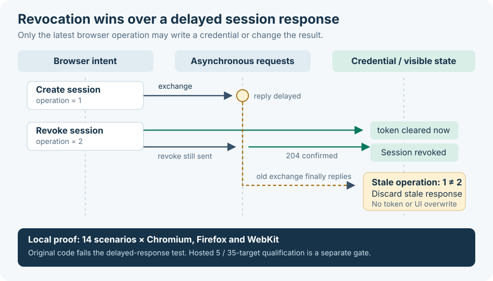

# Browser acceptance

The required Quality gate includes the actual embedded `gateway/web` demo,
served only from an in-memory allowlist on loopback. Session replies are synthetic;
tests never contact Home Assistant, Cloudflare, identity providers or devices.
The gateway and integration retain their existing Go/Python/native contract tests.

Pull requests, beta and nightly releases use five required configurations: current pinned
Chromium, Firefox and WebKit on Linux, Chromium on Windows and WebKit on macOS.
RC releases, scheduled source audits and manual audits without a release channel
use all 35 configurations (three browser generations and supported Chrome/Edge
channels). Stable retains the accepted RC artifact under the existing release policy.
Browser qualification covers the embedded JavaScript and DOM; it does not claim
live Home Assistant or identity-provider compatibility.



The adapter exercises preview without network calls, successful and rejected
exchange, malformed/oversized lifetime contracts, memory-only credential storage,
confirmed and failed revocation, out-of-order exchanges, revoke/preview/pagehide
races (including delayed JSON after response headers), expiration and narrow-screen controls. It confirms that a newer UI action
does not cancel an already-issued server revocation. Every scenario must pass;
errors, unexpected network destinations and missing evidence fail the job.

Run locally after installing one isolated locked Playwright toolchain and its browser:

```sh
npm ci --ignore-scripts --prefix tools/browser-compatibility/playwright-1-64-0
npx --prefix tools/browser-compatibility/playwright-1-64-0 playwright install chromium
CI_PLAYWRIGHT_MODULE="$PWD/tools/browser-compatibility/playwright-1-64-0/node_modules/playwright" \
  CI_BROWSER_ENGINE=chromium node scripts/browser-acceptance.cjs
```

Use `firefox` or `webkit` after installing the matching browser. Traces, screenshots
and result JSON are written to ignored `.compatibility/`. All credentials in the
fixture and its traces are synthetic. No token is read from the local environment.
